  

SRE with 20+ years building the cloud platforms teams run on.

<table>
  <tr><td><b>Working on</b></td><td>Reusable Terraform / AWS modules and CI templates</td></tr>
  <tr><td><b>Sharpening</b></td><td>Kubernetes and platform tooling</td></tr>
  <tr><td><b>Ask me about</b></td><td>Terragrunt, Kubernetes, running things on AWS</td></tr>
</table>

  
  
  
  
  

